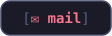
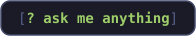

<div align="center">
  
</div>

<div align="center">
  <br>
  <a href="mailto:aadityamehetre@gmail.com"></a>&nbsp;
  <a href="https://linkedin.com/in/aaditya-mehetre"></a>&nbsp;
  <a href="https://github.com/Harbringe/Harbringe/issues"></a>
</div>

<br>

<h2><samp>$ ls ~/projects --featured</samp></h2>

<p align="center">
  <a href="https://github.com/Harbringe/autoca"></a>
</p>
<p align="center">
  <a href="https://github.com/Harbringe/eo-insight"></a>
  <a href="https://github.com/Harbringe/shorts"></a>
</p>

<p align="center"><samp>
  also shipped →
  <a href="https://github.com/Harbringe/AI-integrated-Expense-Claim">ai-expense-claim</a> <sub>(auditable expense agent)</sub> ·
  <a href="https://github.com/Harbringe/JobPilot">jobpilot</a> <sub>(job-application autopilot api)</sub>
</samp></p>

<br>

<h2><samp>$ pip list | grep -iE "genai|vision"</samp></h2>

```text
langchain          rag pipelines · tool-calling agents · auditable orchestration
azure-openai       vision document extraction · confidence-routed human review
huggingface        transformers · model zoo
yolo               v11 · yolo-world · open-vocabulary detection
clip / blip-2      embeddings · captioning (yes, satellite imagery counts)
crnn / cnn         custom OCR — incl. a script that had no dataset until I made one
qdrant / chroma    vector stores doing real retrieval work
celery             async ml pipelines that survive mondays
```

<br>

<h2><samp>$ ls ~/toolbox</samp></h2>

<div align="center">
  
  <br>
  
</div>

<br>

<h2><samp>$ ./render --city contributions</samp></h2>

<div align="center">
  
</div>

<br>

<h2><samp>$ btop --user harbringe</samp></h2>

<div align="center">
  
</div>

<br>

<h2><samp>$ crontab -l</samp></h2>

```bash
# m   h    dom  mon  dow    command
  0   9    *    *    *      ./train_models.sh          # ☕ mornings are for ML
  0   14   *    *    *      ./ship_backends.sh         # 🚀 afternoons ship APIs
  0   23   *    *    *      git commit -m "one more"   # 🌙 every single night
```

<br>

<div align="center">
  <samp>$ shutdown -h now &nbsp;&nbsp;# just kidding — ★ something before you go</samp>
  <br><br>
  
</div>

<!--
        ▀▄   ▄▀
       ▄█▀███▀█▄        you read the source. of course you did.
      █▀███████▀█       curiosity level: dangerous. we should talk →
      █ █▀▀▀▀▀█ █       aadityamehetre@gmail.com
       ▀▀ ▀▀▀ ▀▀
-->
